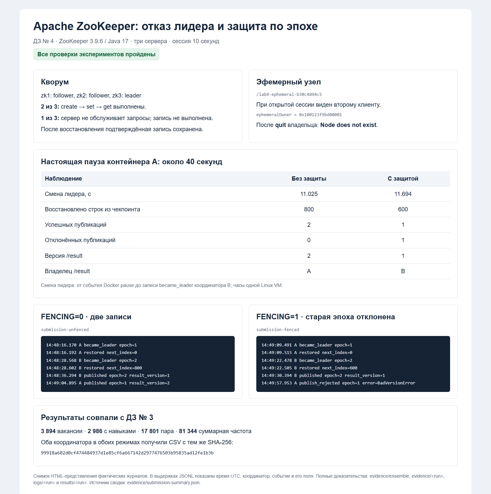

# Отказоустойчивость расчёта пар навыков с Apache ZooKeeper

## 1. Задача и исходный расчёт

Нужно сохранить результат расчёта при остановке активного координатора
и показать, почему одного выбора нового лидера недостаточно для защиты
от запоздавшей записи прежнего лидера.

Использован расчёт из [ДЗ № 3](https://github.com/MaximKastch/hw3_Data_engineering),
коммит `3a0101b690b04ac8bf5962b674afb178de91a401`.
Вариант: вакансии с ролью «Программист, разработчик» и подстрокой `python`
в названии без учёта регистра. Навыки разделяются по `;`, приводятся
к нижнему регистру, лишние пробелы схлопываются, повторения удаляются.
Каждая неупорядоченная пара учитывается один раз на вакансию.

Полный исходный CSV содержит 229 388 строк и занимает 847 619 384 байта.
Для этой работы сохранены все 3 894 строки, проходящие тот же фильтр,
с полями `name`, `role`, `key_skills`. Порядок и строки без навыков сохранены.
Удалены только ненужные столбцы и строки, которые расчёт всё равно отвергает.
Файл проекции занимает 75 994 байта; исходный S3 для повторения экспериментов
не требуется.

| Контроль | Значение ДЗ № 3 |
|---|---:|
| Отобранные вакансии | 3 894 |
| Вакансии с навыками | 2 986 |
| Уникальные пары | 17 801 |
| Сумма частот пар | 81 344 |

SHA-256 полного `counts_2.csv`:

```text
99918a602d0cf474484937d1e85cf6a667142d2977476503b95835ad12fe1b3b
```

[Манифест подготовки](data/manifest.json) содержит SHA-256 исходного CSV,
проекции и шесть успешных проверок. Частоты пересчитаны из навыков и
побайтово сравнены с [эталоном](baseline/counts_2.csv). Исходный `counts_digest`
в метриках ДЗ № 3 охватывает сразу одиночки, пары и тройки; здесь сравнивается
именно CSV пар.

## 2. Ансамбль из трёх серверов

Использован официальный Docker-образ `zookeeper:3.9.6-jre-17`, закреплённый
по digest в [compose.yaml](compose.yaml). На хосте устанавливать Java не нужно.
Серверы запускаются штатным `zkServer.sh` из образа.

| Сервер | myid | Порт хоста → контейнера | Тома данных / транзакций |
|---|---:|---|---|
| zk1 | 1 | 2181 → 2181 | zk1-data / zk1-log |
| zk2 | 2 | 2182 → 2181 | zk2-data / zk2-log |
| zk3 | 3 | 2183 → 2181 | zk3-data / zk3-log |

Внутри контейнеров пути `/data`, `/datalog` и порты одинаковые,
но пространства файлов и сети разделены. Поэтому серверы не перезаписывают
данные друг друга. Строки `server.1`, `server.2`, `server.3` у всех одинаковые;
`myid` определяет собственную строку сервера. `tickTime=2000`, `initLimit=10`,
`syncLimit=5`, допустимый тайм-аут сессии — 4–20 секунд.

Прогон 4 ноября 2026 года зафиксировал следующие состояния:

| Состояние | zk1 | zk2 | zk3 | Проверка |
|---|---|---|---|---|
| Все запущены | follower | follower | leader | Один лидер, два последователя |
| Остановлен zk1 | остановлен | follower | leader | `create`, `set`, `get -s` успешны |
| Остановлены zk1 и zk3 | остановлен | не обслуживает запросы | остановлен | Запись отклонена, код выхода 1 |
| Оба возвращены | follower | follower | leader | Прежнее значение сохранено |

Команды остановки: `docker compose stop zk1`, затем `docker compose stop zk3`.
После первой остановки в `/lab4-quorum-b30c4894c5` записано и прочитано
`updated-with-two`. После второй `zkServer.sh status` на zk2 завершился
с кодом 1. Попытка создать `/lab4-no-quorum-b30c4894c5` не удалась;
после возвращения кворума этот узел по-прежнему отсутствовал.

Доказательства: [роли](evidence/ensemble/summary.json),
[успешная запись на двух серверах](evidence/ensemble/one-down-write-read.txt),
[состояние при двух отказах](evidence/ensemble/two-down-status.txt),
[неудавшаяся запись](evidence/ensemble/two-down-failed-write.txt),
[восстановление](evidence/ensemble/restored-read.txt).
Фактические конфигурации и `myid` сохранены в
[evidence/ensemble/](evidence/ensemble/), версии — в
[java-version.txt](evidence/ensemble/java-version.txt) и
[zookeeper-version.txt](evidence/ensemble/zookeeper-version.txt).

Проверка доступности выполняется реальной записью и чтением через `zkCli`,
а не только ответом на `ruok`: работающий процесс без кворума ещё не означает
доступный сервис записи.

## 3. Эфемерный узел

В отдельном живом клиенте `zkCli` выполнено:

```text
create -e /lab4-ephemeral-b30c4894c5 alive
```

Пока эта сессия открыта, второй клиент на zk2 получил значение `alive`
и `ephemeralOwner = 0x100123f9bd00001`. После `quit` в клиенте-владельце
повторный `get -s` вернул:

```text
Node does not exist: /lab4-ephemeral-b30c4894c5
```

Полные выводы: [клиент-владелец](evidence/ensemble/ephemeral-owner.txt),
[наблюдатель до закрытия](evidence/ensemble/ephemeral-observer-before.txt),
[наблюдатель после закрытия](evidence/ensemble/ephemeral-observer-after.txt).

Закрытие клиента командой `quit` завершает сессию явно. При аварийном
исчезновении клиента узел удалился бы после истечения тайм-аута сессии.

## 4. Координатор и чекпоинт

Две независимые копии A и B используют одну область `/lab4/<run>`.
Тайм-аут сессии — **10 000 мс**. Лидер создаёт эфемерный `/leader`;
создание узла и увеличение `/epoch` выполняются одной транзакцией.
Версия `/epoch` становится неизменяемым токеном данного запуска координатора.

Из ДЗ № 3 сохранены правила отбора, нормализации и map/reduce-подсчёта пар.
Вместо прежнего диспетчера `ProcessPoolExecutor` и чтения из S3 здесь работает
координатор с последовательными порциями и сохранением состояния между ними.
Так проверяется отказоустойчивость расчёта, без повторного развёртывания всего
стенда ДЗ № 3.

Расчёт разбит на 20 порций по 200 выбранных вакансий, последняя короче.
После каждой порции сохраняются накопленные частоты, число обработанных строк
и число вакансий с навыками. Файл чекпоинта сначала записывается целиком;
затем транзакция с проверкой эпохи обновляет указатель `/checkpoint`.
Запасной координатор проверяет хеш файла и входных данных, восстанавливает
агрегат и продолжает со следующей необработанной строки.

Защита чекпоинтов включена в обоих экспериментах. `FENCING` переключает
только защиту конечной публикации. Файлы результатов каждого координатора
раздельные; опубликованным считается результат, на который указывает `/result`.

Чтобы успеть остановить процесс посреди расчёта, после порции добавлена
пауза 0,4 секунды. Это учебное замедление, не измерение скорости алгоритма.
Сам отказ воспроизводится настоящим `docker pause`: останавливается весь
контейнер A, включая поток heartbeat. После примерно 40 секунд контейнер
возобновляется через `docker unpause`.

Старый координатор намеренно позволяет уже начатому вычислению завершиться
после потери сессии и отправить результат со старой эпохой. Так воспроизводится
ситуация с долгой паузой или запоздавшим ответом рабочего процесса. Эпоха
у этой задачи не обновляется. Новая сессия получателя позволяет отделить
проверку права на запись от самого факта истечения сессии координатора.

## 5. Эксперимент без защиты: FENCING=0

Запуск `submission-unfenced`: A получил эпоху 1 и был приостановлен
на 40,000 секунды. B стал лидером эпохи 2 через **11,025 секунды**,
загрузил чекпоинт после 800 выбранных вакансий и обработал оставшиеся 3 094.

В журналах две успешные публикации (время UTC):

```text
14:48:36.294  B  записал результат  epoch=2  result_version=1
14:49:04.895  A  записал результат  epoch=1  result_version=2
```

После возобновления A его старый чекпоинт не принят, но публикация результата
без защиты проходит. Итог: две записи в `/publications`, версия `/result`
равна **2**, указатель принадлежит **A с устаревшей эпохой 1**.
Оба CSV совпадают с эталоном ДЗ № 3.

Доказательства: [журнал A](logs/submission-unfenced/A.jsonl),
[журнал B](logs/submission-unfenced/B.jsonl),
[сводка и замер](evidence/submission-unfenced/summary.json),
[состояние ZooKeeper](evidence/submission-unfenced/zookeeper-state.json),
[вывод `get -s` с `dataVersion = 2`](evidence/submission-unfenced/result-zkcli.txt),
[восстановленный чекпоинт](evidence/submission-unfenced/restored-checkpoint.json),
[команды](evidence/submission-unfenced/commands.txt).

В этом режиме получатель записывает указатель без проверки эпохи.
Истечение сессии удаляет `/leader`, но не отзывает уже вычисленный результат
и не запрещает новому соединению отправить старый запрос. Поэтому старая
задача может перезаписать указатель, хотя запасной координатор уже закончил.

## 6. Эксперимент с защитой: FENCING=1

Запуск `submission-fenced`: A с эпохой 1 приостановлен на 40,000 секунды.
B получил эпоху 2 через **11,694 секунды**, восстановил чекпоинт после
600 выбранных вакансий и обработал оставшиеся 3 294.

```text
14:49:30.394  B  записал результат  epoch=2  result_version=1
14:49:57.953  A  publish_rejected   epoch=1  BadVersionError
```

В `/publications` осталась **одна** публикация. Указатель `/result`
сохранил версию **1** и результат **B с эпохой 2**. A также получил правильные
частоты, но право публиковать их уже потерял. Его попытка записи отклонена
получателем, а не просто пропущена условием в вычисляющем коде.

Доказательства: [журнал A](logs/submission-fenced/A.jsonl),
[журнал B](logs/submission-fenced/B.jsonl),
[сводка и замер](evidence/submission-fenced/summary.json),
[состояние ZooKeeper](evidence/submission-fenced/zookeeper-state.json),
[вывод `get -s` с `dataVersion = 1`](evidence/submission-fenced/result-zkcli.txt),
[восстановленный чекпоинт](evidence/submission-fenced/restored-checkpoint.json),
[команды](evidence/submission-fenced/commands.txt).

[Получатель](src/receiver.py) выполняет одной транзакцией:

```text
check /epoch version=<токен координатора>
set /result <указатель результата>
create /publications/result-<sequence> <запись публикации>
```

При несовпадении эпохи вся транзакция отменяется: не меняются ни указатель,
ни журнал публикаций. Проверяется именно эпоха, а не только версия `/result`:
старый запрос должен быть отклонён уже после выбора нового лидера, даже
если тот пока не успел опубликовать собственный результат.

## 7. Сравнение результатов и времени

| Проверка | FENCING=0 | FENCING=1 |
|---|---:|---:|
| Пауза A, с | 40,000 | 40,000 |
| От `pause` до лидерства B, с | 11,025 | 11,694 |
| Восстановлено строк из чекпоинта | 800 | 600 |
| Обработано B после восстановления | 3 094 | 3 294 |
| Успешные публикации | 2 | 1 |
| Отказ со старой эпохой | нет | `BadVersionError` |
| Версия указателя / владелец | 2 / A | 1 / B |
| CSV координаторов A и B совпали с ДЗ № 3 | да | да |

Все четыре результата имеют 17 801 уникальную пару, сумму частот 81 344
и SHA-256, приведённый в разделе 1. Метрики доступны для
[A без защиты](results/submission-unfenced/A/metrics.json),
[B без защиты](results/submission-unfenced/B/metrics.json),
[A с защитой](results/submission-fenced/A/metrics.json),
[B с защитой](results/submission-fenced/B/metrics.json).

Время измерялось от `timeNano` события `pause` Docker Engine до `time_ns`
события `became_leader` в журнале B. Оба источника используют часы одной
Linux VM Docker Desktop; время Windows с ними не смешивается.
Неокруглённые значения — 11,025043217 и 11,694191739 секунды — сохранены
в [общей сводке](evidence/submission-summary.json). Дополнительно записан
замер монотонными часами от точки перед командой `pause`; он включает
накладные расходы вызова Docker.

Фактическое истечение десятисекундных сессий подтверждает
[серверный журнал zk3](evidence/submission-zk3.log):

```text
14:48:28,461 Expiring session 0x100123f9bd00005, timeout of 10000ms exceeded
14:49:22,315 Expiring session 0x100123f9bd00007, timeout of 10000ms exceeded
```

Это идентификаторы A из событий `started` соответствующих запусков.
Лидер успел сохранить 800 строк в первом опыте и 600 во втором: команда
паузы асинхронна по отношению к вычислению, поэтому положение чекпоинта
может немного различаться. В обоих случаях оно ненулевое и меньше 3 894.

Также прошли три интеграционные проверки на настоящем ансамбле:
старая эпоха отклоняется до и после публикации нового лидера; старый чекпоинт
не откатывает прогресс; без защиты устаревшая публикация проходит.
Вывод `unittest` сохранён в [журнале запуска](evidence/submission-setup.txt)
и [финальной проверке](evidence/final-tests.txt).

Тайм-аут сессии не задаёт точное время переключения. На наблюдаемый интервал
влияют время последнего heartbeat перед паузой, обработка истечения сессии
сервером и ожидание проверки узла запасным координатором.



Изображение — настоящий снимок HTML-представления сохранённых сводок
и выбранных полей JSONL, а не снимок терминала. Доступны также
[HTML](docs/results.html) и [PDF](docs/results.pdf). Исходные текстовые
журналы остаются основным доказательством.

## 8. Ответы на вопросы

### Почему три сервера, а не два или четыре?

Для записи нужно большинство: `floor(N / 2) + 1` серверов.

| Серверов | Нужен кворум | Допустимо отказов |
|---:|---:|---:|
| 2 | 2 | 0 |
| 3 | 2 | 1 |
| 4 | 3 | 1 |

Два сервера после первого отказа теряют большинство. Три сохраняют работу
при одном отказе. Четвёртый участник увеличивает расходы, но для двух отказов
его ещё недостаточно: оставшиеся два из четырёх — только половина.
Для устойчивости к двум отказам нужны пять участников. Большинство также
не позволяет двум непересекающимся частям ансамбля одновременно принимать
согласованные записи. Это соответствует
[правилам развёртывания ZooKeeper](https://zookeeper.apache.org/doc/r3.9.6/zookeeperAdmin.html#sc_zkMulitServerSetup).

### Почему эпоху проверяет получатель записи, а не ZooKeeper?

ZooKeeper сообщает, кто владеет текущей сессией и какая эпоха выдана,
но не может остановить поток старого приложения или отозвать его запрос,
который уже находится в сети. Проверка самим координатором перед отправкой
тоже оставляет промежуток: между проверкой и записью может появиться новый лидер.

Поэтому получатель должен атомарно проверить токен и выполнить запись.
Если результат хранится во внешней БД, проверка должна происходить в её
транзакции или условной операции. Отдельный запрос к ZooKeeper перед записью
в БД не делает эти два действия атомарными.

В этой лабораторной получателем небольшого указателя является сам ZooKeeper,
поэтому проверка версии `/epoch` и изменение `/result` входят в одну
ZooKeeper-транзакцию. Противоречия нет: защита работает именно там, где
принимается запись. Версии узлов и семантика эфемерных узлов описаны в
[руководстве программиста](https://zookeeper.apache.org/doc/r3.9.6/zookeeperProgrammers.html).

## 9. Границы эксперимента

Все три сервера и общая папка чекпоинтов находятся на одном компьютере.
Они изолируют процессы и данные серверов, но не защищают от отказа хоста
или его диска. В реальном развёртывании серверы разносят по машинам,
а чекпоинты хранят в доступном после отказа хранилище. Здесь проверялись
кворум, истечение сессии, восстановление вычислений и защита от старой эпохи.
